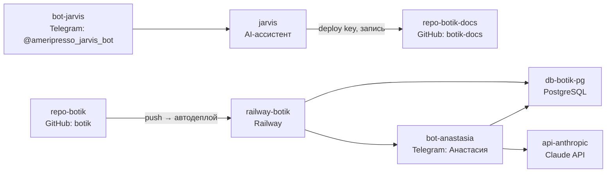

# Карта инфраструктуры — botik

Собрана из `registry.yaml`. Общий уровень — только крупные блоки.  

`repo-botik-docs` не подключён к деплою — используется отдельно для планирования (см. `CLAUDE.md`), связи с `railway-botik` нет. `jarvis` — внешний относительно инфраструктуры `botik` AI-ассистент, подключён только к `repo-botik-docs` (запись через deploy key).
