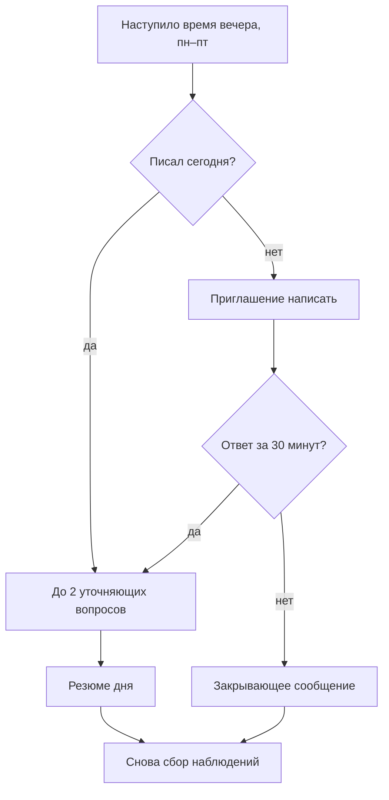

# Блок 4. Вечер

> Пример. Правила сокращены.

**Кратко (TL;DR).** По будням в выбранное пользователем время бот либо задаёт до двух уточняющих вопросов и присылает резюме дня, либо, если день был пустой, приглашает написать и через 30 минут присылает закрывающее сообщение.

## Правила

| № | Правило | Параметр |
|---|---|---|
| B4-01 | Вечер начинается по будням (пн–пт) во время из контракта; по умолчанию 20:00 | [P-EVENING-DEFAULT](../parameters.md#время-вечера) |
| B4-02 | Если пользователь писал в течение дня, бот задаёт до 2 уточняющих вопросов по одному (мысли → чувства → тело → потребность) и присылает резюме дня | [P-EVENING-QUESTIONS](../parameters.md#окна-ожидания) |
| B4-03 | Если день пустой, бот присылает приглашение и ждёт ответа 30 минут, затем закрывающее сообщение | [P-EVENING-REPLY-MIN](../parameters.md#окна-ожидания) |
| B4-04 | Весь вечер не длится дольше 1,5 часа | [P-EVENING-TOTAL-MIN](../parameters.md#окна-ожидания) |
| B4-05 | Кризисное сообщение прерывает вечер: резюме не присылается | см. [решение о кризисе](../decisions/2026-10-14-evening-timeouts.md) |

## Схема

## Связанное

- Какие команды работают во время вечера: [commands.md](../commands.md#поведение-в-особых-состояниях).
- Что происходит, если пользователь молчит несколько дней подряд: [Блок 5. Молчание](5-silence.md).
- Тексты приглашения и закрывающих сообщений лежат в коде: ключи `EVENING_INVITE_MESSAGES` и `CLOSING_EMPTY_DAY` в `texts.py`.

[← К оглавлению](../README.md)
