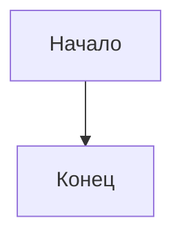

# Блок N. Название

**Кратко (TL;DR).** До 5 строк: что делает блок, чем начинается, чем заканчивается, где ключевые правила.

## Правила

| № | Правило | Параметр |
|---|---|---|
| B0-01 | Текст правила (что должно быть). Числа и времена — ссылкой на параметр | [P-…](../parameters.md#раздел) |

Тексты Насти: ключ `ИМЯ_КЛЮЧА` в `texts.py` (текст в спеке не дублируем).

## Схема

## Эталонные диалоги

Пример 1: пользователь пишет → бот отвечает. Служат тестовыми сценариями и чек-листом для ручной проверки.

## Связанное

- Команды: [commands.md](../commands.md)
- Соседний блок: [Блок N+1](N-name.md)
- Решения: [decisions/…](../decisions/…)

[← К оглавлению](../README.md)
