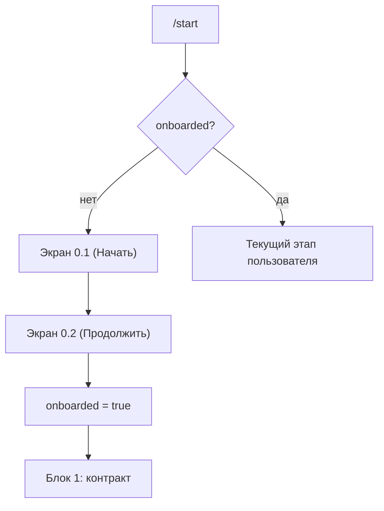

# Блок 0. Онбординг (один раз, при первом `/start`)

**Кратко (TL;DR).** При первом `/start` бот показывает два экрана: приветствие (0.1) и инструкцию «как это работает» (0.2). После «Продолжить» на экране 0.2 пользователь переходит к [Блоку 1 (контракт)](1-contract.md). Экраны не повторяются. Пояснение про выходные в тексты пока не включено (ждёт формулировку Насти).

## Правила

| № | Правило | Параметр |
|---|---|---|
| B0-01 | Флаг `onboarded` в профиле пользователя по умолчанию `false`. При `onboarded = false` команда `/start` показывает экран 0.1 | — |
| B0-02 | Экран 0.1 (приветствие) заканчивается кнопкой «Начать». Нажатие отправляет экран 0.2 отдельным сообщением; экран 0.1 остаётся в истории чата | — |
| B0-03 | Экран 0.2 (инструкция «как это работает») заканчивается кнопкой «Продолжить». После нажатия `onboarded` становится `true` и начинается Блок 1 (контракт) | — |
| B0-04 | При `onboarded = true` команда `/start` ведёт сразу в текущий этап пользователя; экраны 0.1 и 0.2 не повторяются | — |
| B0-05 | Порядок «инструкция до контракта» — как предлагала Настя; после контракта идут Блок 2 (определение фокуса), затем ежедневный режим (Блок 3) | — |
| B0-06 | В онбординге коротко объясняется, как бот работает в субботу и воскресенье: в субботу приходит итог недели; суббота и воскресенье — дни паузы; вечерних резюме нет; писать можно, а можно не писать; всё присланное за выходные учтётся в понедельник. Пояснение добавляется отдельным сообщением или абзацем (текст экрана 0.2 не меняется) | — |

## Тексты Насти

| Что | Ключ в `texts.py` | Статус |
|---|---|---|
| Экран 0.1 — приветствие | `ONBOARDING_SCREEN_1_TEXT` | есть, дословно из заметок Насти ([встреча 2026-09-11](../../meetings/2026-09-11-заметки-насти-по-схеме.md)) |
| Экран 0.2 — инструкция | `ONBOARDING_SCREEN_2_TEXT` | есть; правка шагов 1 и 6: [решение](../decisions/2026-10-14-onboarding-text-request-focus.md) |
| Пояснение про выходные | `ONBOARDING_WEEKENDS_TEXT` | заглушка (пустая строка), ждёт текст Насти |

## Схема

## Связанное

- Команды: [commands.md](../commands.md) (`/start`, `/rules`: описание формата — экран 0.2)
- Следующий блок: [Блок 1 — контракт](1-contract.md)
- Решения: [правка текста экрана 0.2](../decisions/2026-10-14-onboarding-text-request-focus.md), [пояснение про выходные](../decisions/2026-10-13-onboarding-weekends.md)
- Глоссарий: [запрос и фокус](../glossary.md)

[← К оглавлению](../README.md)
