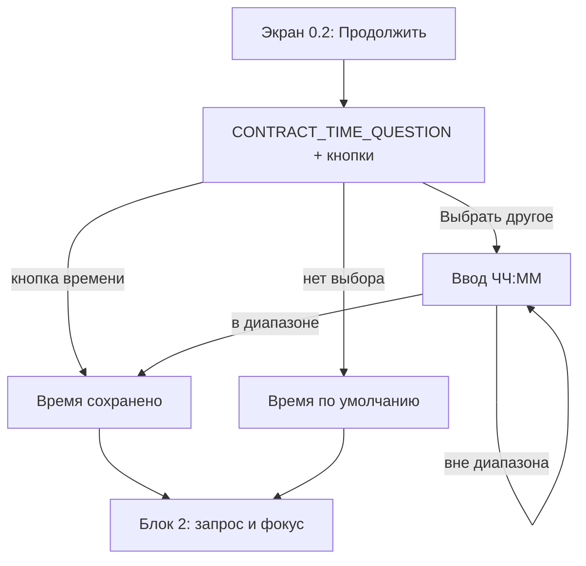

# Блок 1. Контракт (один раз, на старте)

**Кратко (TL;DR).** Контракт — один вопрос с кнопками: в какое время присылать вечернее резюме. Своё время можно ввести вручную в разрешённом диапазоне. Если выбора нет, действует время по умолчанию. Остальное (утреннее сообщение, реакция на молчание) работает по умолчанию без выбора. Настройки меняются командой `/settings`.

## Правила

| № | Правило | Параметр |
|---|---|---|
| B1-01 | Контракт — один вопрос с кнопками; свободный ввод не используется (ответ ложится в БД без интерпретации), кроме ввода своего времени по кнопке «Выбрать другое» | — |
| B1-02 | Вопрос: время вечернего резюме. Кнопки: четыре варианта времени и «Выбрать другое» | [P-CONTRACT-TIME-OPTIONS](../parameters.md#онбординг-и-контракт-блоки-01) |
| B1-03 | «Выбрать другое» — ввод времени вручную в формате ЧЧ:ММ только в разрешённом диапазоне; время вне диапазона бот просит ввести заново | [P-EVENING-TIME-MIN, P-EVENING-TIME-MAX](../parameters.md#онбординг-и-контракт-блоки-01) |
| B1-04 | Если пользователь не выбрал время (закрыл или проигнорировал контракт) — время резюме по умолчанию | [P-EVENING-TIME-DEFAULT](../parameters.md#онбординг-и-контракт-блоки-01) |
| B1-05 | Утреннее сообщение (пн–пт) включено по умолчанию, отдельного выбора на старте нет (поведение — [Блок 3](../README.md)) | [P-MORNING-TIME](../parameters.md#онбординг-и-контракт-блоки-01) |
| B1-06 | Реакция на молчание 3 будних дня — стандартный сценарий, отдельного выбора на старте нет (поведение — [Блок 5](../README.md)) | — |
| B1-07 | Настройки можно посмотреть и изменить в любой момент командой `/settings`: она показывает текущие параметры (включая время резюме) с кнопками редактирования | — |
| B1-08 | В `/settings` один пункт — время вечернего резюме (только настройки контракта): те же кнопки и тот же диапазон, что в контракте. Часовой пояс не настраивается (GMT+3 для всех) | [P-EVENING-TIME-MIN, P-EVENING-TIME-MAX](../parameters.md#онбординг-и-контракт-блоки-01) |
| B1-09 | В `/settings`: если после «Выбрать другое» пришло не время — выбор отменяется, а сообщение обрабатывается как обычное (наблюдение, с кризисной проверкой) | — |
| B1-10 | Из контракта убраны вопросы про напоминания и про молчание 3+ дня; сами функции работают по умолчанию | — |

Тексты Насти: вопрос контракта — ключ `CONTRACT_TIME_QUESTION` в `texts.py` (текст в спеке не дублируем). Служебные подсказки ввода своего времени (`CUSTOM_TIME_ASK`, `CUSTOM_TIME_OUT_OF_RANGE` в `handlers/v2.py`) — заготовки разработки, не тексты Насти.

## Схема

## Связанное

- Предыдущий блок: [Блок 0 — онбординг](0-onboarding.md)
- Команды: [commands.md](../commands.md) (`/settings`)
- Решения: [контракт только про время](../decisions/2026-09-15-contract-time-only.md), [диапазон своего времени](../decisions/2026-10-14-custom-time-range.md)

[← К оглавлению](../README.md)
