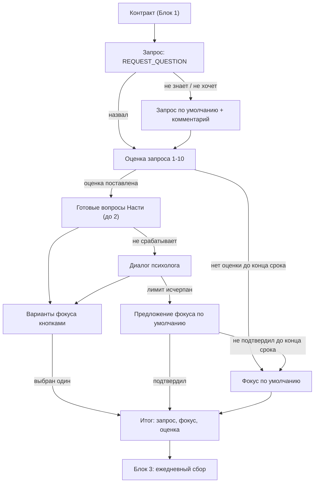

# Блок 2. Запрос, оценка и фокус (старт)

**Кратко (TL;DR).** После контракта пользователь называет **запрос** (долгоживущая тема, можно не называть), ставит **оценку запроса 1–10**, затем определяет **фокус недели** в рамках запроса: готовые вопросы Насти, при необходимости диалог в режиме психолога, три варианта кнопками и подтверждение одного. Не определил к концу срока — фокус по умолчанию. Затем бот переходит в ежедневный сбор ([Блок 3](3-daily.md)). Определения «запрос» и «фокус» — в [glossary.md](../glossary.md); сферы жизни (колесо баланса) единицей оценки не являются.

## Правила

| № | Правило | Параметр |
|---|---|---|
| B2-01 | Порядок старта: запрос → оценка запроса → фокус. Открытый вопрос «Что сейчас важно или беспокоит» задаётся один раз, как вопрос о запросе, и в определении фокуса не повторяется | — |
| B2-02 | Запрос называется по желанию. Кнопки «Пока не знаю» нет: если в ответе видно, что пользователь не знает или не хочет называть запрос, нейронка это распознаёт и ставится запрос по умолчанию | — |
| B2-03 | Если пользователь не знает, с чего начать, бот помогает выбрать сферу, где больше всего напряжения (колесо баланса), и конкретизировать запрос | — |
| B2-04 | Запрос по умолчанию: «научиться осознанной рефлексии — наблюдению за собой и своим состоянием». Бот сопровождает его коротким комментарием о цели инструмента. Оценка для запроса по умолчанию обязательна; сменить его на свой можно только в месячном срезе ([Блок 7](../README.md)) | — |
| B2-05 | Оценка запроса 1–10 обязательна, даётся сразу после запроса; кнопки 1–5 и 6–10 (два ряда). Это единственная стартовая оценка: оценки по фокусу нет. Точка отсчёта, не зачёт. Шкала везде 1–10 (старт, месячный срез, дашборд) | [P-SCORE-RANGE](../parameters.md#ежедневный-сбор-и-фокус-блоки-23) |
| B2-06 | Пока оценки нет, бот к фокусу не переходит и не напоминает. Если до конца срока ничего не произошло, ставится фокус по умолчанию (B2-13), а оценку бот спрашивает снова при следующем сообщении пользователя | [P-STAGE-MIN-HOURS](../parameters.md#ежедневный-сбор-и-фокус-блоки-23) |
| B2-07 | После онбординга ([Блок 0](0-onboarding.md)) и контракта ([Блок 1](1-contract.md)) бот предлагает определить фокус: за чем человек будет наблюдать на этой неделе | — |
| B2-08 | Базовая схема: готовые вопросы Насти, до двух уточняющих, на которые человек отвечает явно; больше двух по этой схеме не задаётся | [P-FOCUS-CLARIFY-MAX](../parameters.md#ежедневный-сбор-и-фокус-блоки-23) |
| B2-09 | Если человек не понимает вопросов, задаёт встречные или не может прийти к выбору, дальше диалог ведёт нейронка в режиме психолога Анастасии: выяснить, в чём основная проблема, и сформулировать, за чем наблюдать | — |
| B2-10 | Лимит этапа (готовые вопросы и диалог психолога — один этап): не более 20 сообщений пользователя (ответы бота не считаются) или до конца текущего дня (GMT+3), но не меньше 3 часов от начала этапа. Фокус определён раньше — этап заканчивается раньше | [P-FOCUS-MSG-LIMIT](../parameters.md#ежедневный-сбор-и-фокус-блоки-23), [P-STAGE-MIN-HOURS](../parameters.md#ежедневный-сбор-и-фокус-блоки-23) |
| B2-11 | Когда бот понял проблему, он предлагает несколько вариантов фокуса кнопками; пользователь подтверждает только один. Без нажатия фокус не фиксируется. Число вариантов и поведение, если ни один не подходит — [допущение](../decisions/2026-10-14-focus-three-options.md) | [P-FOCUS-OPTIONS-COUNT](../parameters.md#ежедневный-сбор-и-фокус-блоки-23) |
| B2-12 | Если лимит исчерпан или пользователь ушёл, бот предлагает фокус по умолчанию «понять, что меня беспокоит» с кнопкой подтверждения, как в B2-11 ([допущение](../decisions/2026-10-14-focus-limit-exhausted.md)) | — |
| B2-13 | Если пользователь ушёл и не подтвердил ни один фокус, в конце срока фокус по умолчанию ставится автоматически, без нажатия, и бот отправляет уточняющее сообщение. «Меню бота» в нём — команда `/focus` ([commands.md](../commands.md)) | [P-STAGE-MIN-HOURS](../parameters.md#ежедневный-сбор-и-фокус-блоки-23) |
| B2-14 | Фокус по умолчанию действует, пока пользователь не выберет личный (в `/focus` или в субботу, [Блок 6](../README.md)); наблюдение за тем, что беспокоит, — старт для определения любых фокусов | — |
| B2-15 | Фиксация и переход: бот озвучивает итог (запрос, фокус, оценка запроса). Фокус действует до субботнего резюме, где пользователь оставляет текущий, выбирает один из трёх или свой ([Блок 6](../README.md)); сменить его можно и раньше ([B3-20](3-daily.md)). Далее — режим ежедневных наблюдений ([Блок 3](3-daily.md)) | — |
| B2-16 | Оценка запроса принимается и числом (1–10) вместо кнопки ([допущение](../decisions/2026-10-14-score-as-number.md)) | [P-SCORE-RANGE](../parameters.md#ежедневный-сбор-и-фокус-блоки-23) |
| B2-17 | Срок этапа («до конца дня, но не меньше 3 часов») действует и для этапа запроса и оценки; не назвал запрос до срока — запрос по умолчанию ставится вместе с фокусом по умолчанию ([допущение](../decisions/2026-10-14-focus-stage-deadline.md)) | [P-STAGE-MIN-HOURS](../parameters.md#ежедневный-сбор-и-фокус-блоки-23) |
| B2-18 | Базовая схема остаётся началом диалога; признак «схема не срабатывает» ([допущение](../decisions/2026-10-14-focus-base-scheme-start.md)) | — |

## Тексты Насти

Ключи в `texts.py` / `prompts.py` (текст в спеке не дублируем):

- вопрос о запросе — `REQUEST_QUESTION` (B2-01);
- оценка запроса — `REQUEST_SCORE_QUESTION` (B2-05);
- готовые уточняющие вопросы — `FOCUS_CLARIFY_QUESTIONS` (B2-08);
- диалог психолога — `FOCUS_DIALOG_PROMPT`, `FOCUS_NEXT_OPTION` в `prompts.py` (B2-09);
- уточняющее сообщение при автоматическом фокусе по умолчанию — `FOCUS_DEFAULT_AUTO_TEXT` (B2-13);
- комментарий к запросу по умолчанию (B2-04): ключ `DEFAULT_REQUEST_COMMENT` в `texts.py` пока пуст (TBD-Настя), готового текста в texts.py нет; черновик по смыслу Тимура, формулировку подтвердить:

> Если пока сложно назвать, с чем ты пришла, — ничего страшного. Начнём с главного: этот инструмент помогает научиться осознанной рефлексии, то есть замечать, что происходит с тобой и твоим состоянием. Это и будет нашим запросом на старте, а свой запрос ты сможешь назвать позже.

## Схема

## Связанное

- Предыдущий блок: [Блок 1 — контракт](1-contract.md); следующий: [Блок 3 — ежедневный сбор](3-daily.md)
- Команды: [commands.md](../commands.md) (`/focus`, `/start`)
- Параметры: [parameters.md](../parameters.md)
- Решения: [базовая схема](../decisions/2026-10-14-focus-base-scheme-start.md), [три варианта](../decisions/2026-10-14-focus-three-options.md), [лимит исчерпан](../decisions/2026-10-14-focus-limit-exhausted.md), [срок этапа](../decisions/2026-10-14-focus-stage-deadline.md), [оценка числом](../decisions/2026-10-14-score-as-number.md)

[← К оглавлению](../README.md)
