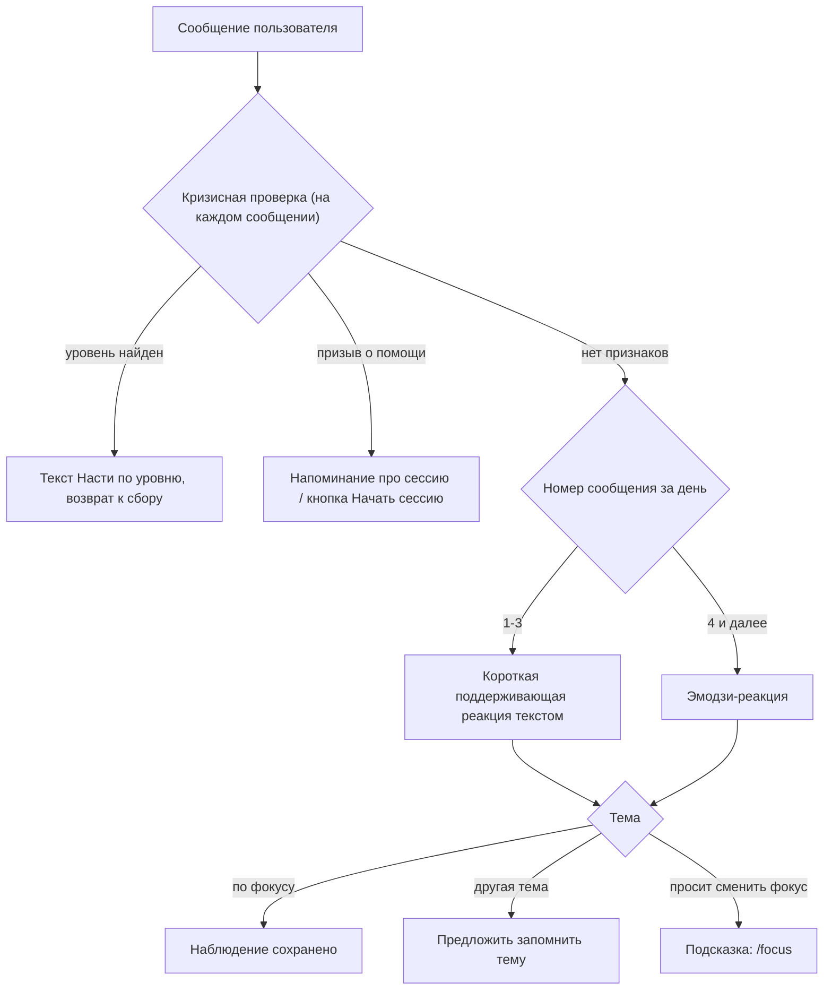

# Блок 3. Ежедневный сбор наблюдений

**Кратко (TL;DR).** Бот не ведёт диалог, а собирает наблюдения: пользователь пишет, когда что-то произошло. На первые 3 сообщения дня бот отвечает короткой поддерживающей реакцией, дальше ставит эмодзи. Утром пн–пт бот пишет первым. Каждое сообщение проверяется на кризис. Призыв о помощи и уход на другую тему обрабатываются отдельно; фокус меняется одним путём — `/focus`. Механика «3 сообщения текстом, дальше эмодзи» реализована Тимуром и **не согласована с Настей**: при тестировании спросить её мнение о самой механике.

## Правила

| № | Правило | Параметр |
|---|---|---|
| B3-01 | Режим дня — «только приём»: пользователь пишет в любое удобное время, в моменте, когда что-то произошло | — |
| B3-02 | Утреннее сообщение (пн–пт): бот пишет первым, один из 5 вариантов Насти. Подстановки: фокус недели и время вечернего резюме из контракта | [P-MORNING-VARIANTS](../parameters.md#ежедневный-сбор-и-фокус-блоки-23), [P-MORNING-TIME](../parameters.md#онбординг-и-контракт-блоки-01) |
| B3-03 | Номер варианта считается по порядку отправки, а не по дню недели: первое отправленное утреннее сообщение — вариант 1, где бы пользователь ни стартовал, дальше 2…5. Номер сдвигается только при реальной отправке (не ушло — номер остаётся). В субботу счётчик обнуляется | [P-MORNING-VARIANTS](../parameters.md#ежедневный-сбор-и-фокус-блоки-23) |
| B3-04 | Условие отправки утреннего: за день пользователь ещё ничего не писал; состояние `active` ([Блок 5](5-silence.md)). Это единственное напоминание в течение дня. В сб и вс не отправляется | — |
| B3-05 | Утреннее уходит только после того, как фокус определён; «уже писал сегодня» — любое сообщение после 00:00 GMT+3; кто заблокировал бота — в этот день больше не пытаемся, номер варианта не сдвигается ([допущение](../decisions/2026-10-14-morning-send-conditions.md)) | [P-MORNING-TIME](../parameters.md#онбординг-и-контракт-блоки-01) |
| B3-06 | Счётчик сообщений сбрасывается каждый день, в том числе в сб и вс; день считается по дате GMT+3 | — |
| B3-07 | Что считается наблюдением дня: сообщение, принятое в режиме сбора. Ответы на этапах запроса, оценки и определения фокуса ([Блок 2](2-focus.md)) и сообщения сессии наблюдениями не считаются ([допущение](../decisions/2026-10-14-observation-definition.md)) | — |
| B3-08 | Первые 3 сообщения дня: короткая поддерживающая обратная связь — зеркальное переформулирование сказанного плюс одна фраза о ценности таких наблюдений; без анализа содержания. Кризисные сообщения и просьбы о помощи входят в счёт, но отражения на них нет | [P-DAILY-TEXT-REPLIES](../parameters.md#ежедневный-сбор-и-фокус-блоки-23) |
| B3-09 | С 4-го сообщения дня, если признаков кризиса нет: реакция эмодзи на сообщение, без текста. При сбое генерации отражения (B3-08) тоже эмодзи | [P-REACTION-EMOJI](../parameters.md#ежедневный-сбор-и-фокус-блоки-23) |
| B3-10 | Кризисная проверка выполняется на каждом сообщении пользователя во всех режимах (сбор, выходные, вечерние ответы, диалог фокуса, субботний поток, сессия). При сбое проверки (ошибка API, неразборчивый ответ) бот отвечает как без признаков кризиса и пишет сбой в лог; кризисный текст по сбою не отправляется | — |
| B3-11 | Кризисный сигнал: бот выходит из режима приёма, признаёт тяжесть и отправляет готовый текст Насти (дословно, без нейронки) по уровню (таблица ниже), затем возвращается к обычному режиму сбора; диалог сам не начинает, ждёт ответа пользователя | — |
| B3-12 | Красный уровень не отличается от остальных по тому, что происходит дальше: тема недели не снимается, согласие на возврат к фокусу не требуется | — |
| B3-13 | Уровень определяет нейронка по логике текста Насти и смыслу сообщения (маркеры — ориентир); проверка с тремя уровнями — `CRISIS_LEVEL_PROMPT` | — |
| B3-14 | Контакт Анастасии (`@joyul_psy`) в кризисных текстах не используется: режим по умолчанию — сбор данных о рефлексии, а не диалог с психологом | — |
| B3-15 | Призыв о помощи или срочное без кризисных маркеров: бот в диалог не переходит, остаётся сбор. Вместо обычной реакции напоминает про сессию: если есть неиспользованная сессия этой недели — предлагает запустить её сейчас (кнопка «Начать сессию», как «Сейчас» в [Блоке 6](../README.md)); если нет (использована, сгорела, отчёта ещё не было) — только напоминание, когда она будет (дата ближайшей субботы). Текст генерирует нейронка (готового текста Насти нет). Признак определяется той же проверкой, что и кризис (отдельный ответ классификатора) | — |
| B3-16 | Если пользователь уходит на другую тему (отдельная короткая проверка нейронкой: по фокусу / другая тема / просит сменить фокус), бот признаёт сказанное и предлагает запомнить тему кнопками «Да, запомни» / «Не нужно»; предложение не чаще раза в день, дальше такие сообщения — обычные наблюдения. Запомненные темы используются при субботнем выборе фокуса ([Блок 6](../README.md)). Пока фокус по умолчанию, проверка не выполняется ([допущение](../decisions/2026-10-14-off-topic-check.md)) | [P-OFFTOPIC-OFFERS-PER-DAY](../parameters.md#ежедневный-сбор-и-фокус-блоки-23) |
| B3-17 | Если пользователь настаивает на смене темы (прямо просит сменить фокус), бот подсказывает сменить его через `/focus` | — |
| B3-18 | Базовая версия поддерживает один фокус наблюдения; несколько фокусов одновременно — расширенная версия (не описана) | — |
| B3-19 | Выходные (сб, вс): бот реагирует на наблюдения по тем же правилам, но сам не пишет и вечернего резюме не присылает. Накопленное попадает в резюме понедельника ([Блок 4](4-evening.md)). Суббота и воскресенье — дни паузы: обдумать недельное резюме и отдохнуть от рефлексии; об этом пользователю говорится заранее ([Блок 0](0-onboarding.md)) и после субботнего резюме ([Блок 6](../README.md)) | — |
| B3-20 | Смена фокуса — один путь, `/focus`: под текущим запросом (с последней оценкой) и фокусом кнопки «Предложи варианты» (три фокуса по накопленному материалу в рамках того же запроса, кнопки с номерами) и «Свой фокус» (фраза → уточнённая формулировка → подтверждение кнопкой). `/dashboard` ведёт туда же кнопкой «Сменить фокус»; `/settings` — только контракт. Запрос при смене фокуса не меняется ([решение](../decisions/2026-10-14-focus-change-one-path.md)) | [P-FOCUS-OPTIONS-COUNT](../parameters.md#ежедневный-сбор-и-фокус-блоки-23), [P-FOCUS-CHANGE-OWN-MAX-HOURS](../parameters.md#ежедневный-сбор-и-фокус-блоки-23) |

### Кризисные уровни (к B3-11)

| Уровень | Маркеры (от Насти, ориентир, не закрытый список) | Ключ текста |
|---|---|---|
| 🔴 Красный, острая угроза | прямые упоминания «хочу умереть», «не хочу жить», «лучше бы меня не было», «покончить с собой», «суицид», «порезать себя», «причинить себе вред»; угроза другому человеку; описание происходящего прямо сейчас насилия (физического, сексуального) | `CRISIS_RED_MESSAGE` |
| 🟠 Оранжевый, острое состояние | «паническая атака», «не могу дышать», «сильно трясёт», «полный ужас», «не контролирую себя», «на грани»; сильная острая травма (ПТСР-реакция прямо сейчас) | `CRISIS_ORANGE_MESSAGE` |
| 🟡 Жёлтый, сильный стресс (не кризис) | «очень тяжело», «не справляюсь», «ничего не хочу», «пустота», длительная апатия | `CRISIS_YELLOW_MESSAGE` |

## Тексты Насти

Ключи в `texts.py` / `prompts.py` (текст в спеке не дублируем):

- утренние сообщения — `MORNING_MESSAGES` (5 вариантов, источник — `tasks/11-morning-message.md`, BOT-18) (B3-02);
- кризисные тексты — `CRISIS_RED_MESSAGE`, `CRISIS_ORANGE_MESSAGE`, `CRISIS_YELLOW_MESSAGE`, словарь `CRISIS_MESSAGES` (B3-11);
- предложение запомнить тему — `OFF_TOPIC_OFFER_TEXT` (B3-16);
- отражение на первые 3 сообщения — инструкция Насти `DAILY_MIRROR_PROMPT_NASTYA` в `prompts.py` пока пуста (`None`), используется `DAILY_MIRROR_PROMPT_DEFAULT` с пометкой `TBD-Настя` (B3-08);
- напоминание при просьбе о помощи — `HELP_REMINDER_PROMPT`, `HELP_SESSION_AVAILABLE`, `HELP_SESSION_NEXT` (B3-15, генерирует нейронка).

## Схема

## Эталонные диалоги

Пример реакции на сообщение из первых трёх (из спеки):

> *«Ты заметил, что злишься, когда тебя перебивают — и зафиксировал это. Именно такие моменты в итоге и показывают самое важное»*

## Связанное

- Предыдущий блок: [Блок 2 — фокус](2-focus.md); следующие — вечер ([Блок 4](4-evening.md)), молчание ([Блок 5](5-silence.md))
- Команды: [commands.md](../commands.md) (`/focus`, `/dashboard`, `/settings`, `/session`)
- Параметры: [parameters.md](../parameters.md)
- Решения: [что считается наблюдением](../decisions/2026-10-14-observation-definition.md), [условия утреннего](../decisions/2026-10-14-morning-send-conditions.md), [проверка другой темы](../decisions/2026-10-14-off-topic-check.md), [смена фокуса одним путём](../decisions/2026-10-14-focus-change-one-path.md)

[← К оглавлению](../README.md)
