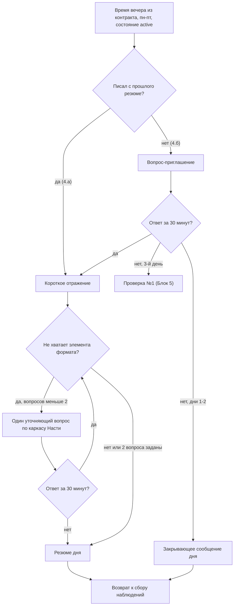

# Блок 4. Вечер — работа с днём и резюме

**Кратко (TL;DR).** Пн–пт в согласованное время бот ведёт вечерний диалог: если пользователь писал с прошлого резюме — до 2 уточняющих вопросов по недостающим элементам формата (мысли / чувства / тело / потребность) и резюме дня; если не писал — вопрос-приглашение, а без ответа за 30 минут — закрывающее сообщение. Вечер не дольше 1,5 часа. После резюме бот возвращается к сбору наблюдений. **Структура резюме и формулировка закрытия дня не согласованы с Настей.**

## Правила

| № | Правило | Параметр |
|---|---|---|
| B4-01 | Вечер — пн–пт в согласованное время из контракта (по умолчанию 20:00 GMT+3). В сб и вс вечернего резюме нет; резюме понедельника охватывает всё накопленное с пятницы, включая выходные (подтверждено Настей 2026-10-13) | [P-EVENING-TIME-DEFAULT](../parameters.md#онбординг-и-контракт-блоки-01) |
| B4-02 | Охват резюме — от резюме до резюме: каждое учитывает все наблюдения после предыдущего резюме (или закрывающего сообщения), а не за календарные сутки. Сообщения сессии с психологом ([Блок 6](../README.md)) в охват не входят ([решение](../decisions/2026-10-14-evening-scope-between-summaries.md); [состав резюме](../decisions/2026-10-14-evening-summary-contents.md)) | — |
| B4-03 | Ветка вечера: «писал с момента предыдущего резюме» — 4.а (уточняющие вопросы и резюме); «не писал» — 4.б (приглашение и закрывающее) | — |
| B4-04 | Вечерние сообщения, закрывающие сообщения и вечерние рефлексии отправляются только в состоянии `active` ([Блок 5](5-silence.md)); в `checking`, `paused`, `dormant` не отправляются ([условия начала](../decisions/2026-10-14-evening-start-conditions.md)) | [P-EVENING-START-WINDOW-MIN](../parameters.md#вечер-и-молчание-блоки-45) |
| B4-05 | Ответ на любой вечерний вопрос (приглашение 4.б, уточняющий вопрос 4.а) бот ждёт 30 минут ([решение](../decisions/2026-10-14-evening-timing.md)) | [P-EVENING-ANSWER-WAIT-MIN](../parameters.md#вечер-и-молчание-блоки-45) |
| B4-06 | Уточняющих вопросов в 4.а — не больше 2 за вечер | [P-EVENING-MAX-QUESTIONS](../parameters.md#вечер-и-молчание-блоки-45) |
| B4-07 | Весь вечер — от первого вопроса до резюме или закрывающего сообщения — не дольше 1,5 часа | [P-EVENING-MAX-MIN](../parameters.md#вечер-и-молчание-блоки-45) |
| B4-08 | Своё время резюме в контракте («Выбрать другое») — только 18:00–22:30 ([Блок 1](1-contract.md)); так вечер заканчивается до полуночи, фиксированного дедлайна 23:00 нет | [P-EVENING-TIME-MIN](../parameters.md#онбординг-и-контракт-блоки-01), [P-EVENING-TIME-MAX](../parameters.md#онбординг-и-контракт-блоки-01) |
| B4-09 | 4.а: нужна, если в сообщениях есть ситуация и мысли, но нет чего-то из формата: мысли / чувства / тело / потребность. Задача — научить пользователя держать структуру наблюдения. Шаги: (1) короткое отражение (генерирует нейронка по каркасу Насти; вариант зависит от того, было одно сообщение или несколько); (2) уточняющий вопрос по каркасу Насти про недостающий элемент. Порядок: мысли → чувства → тело → потребность (порядок формата в экране 0.2 — уточнить у Насти). Если не хватает нескольких элементов — по одному за раз: вопрос, ответ, следующий элемент | [P-EVENING-MAX-QUESTIONS](../parameters.md#вечер-и-молчание-блоки-45) |
| B4-10 | Нейронка определяет, каких элементов формата не хватает, и спрашивает только про них; вместо `[…]` подставляет конкретный момент из сообщений пользователя. Формулировки Насти не переписываются: меняются только подставляемые детали ([как формулируются вопросы](../decisions/2026-10-14-evening-questions-technique.md)) | — |
| B4-11 | Когда все недостающие элементы спрошены (не больше 2 вопросов) или за 30 минут нет ответа, бот формирует и отправляет резюме дня | [P-EVENING-ANSWER-WAIT-MIN](../parameters.md#вечер-и-молчание-блоки-45) |
| B4-12 | 4.б: бот отправляет вечерний вопрос-приглашение — один из трёх чередующихся вариантов Насти с подстановкой фокуса. Выбор по кругу, у каждого пользователя свой счётчик | [P-EVENING-INVITE-VARIANTS](../parameters.md#вечер-и-молчание-блоки-45) |
| B4-13 | Ответ на приглашение за 30 минут — переход на 4.а (уточняющий вопрос → резюме дня) | [P-EVENING-ANSWER-WAIT-MIN](../parameters.md#вечер-и-молчание-блоки-45) |
| B4-14 | Нет ответа на приглашение за 30 минут — бот отправляет закрывающее сообщение дня (не резюме). У каждого из 3 вариантов своя пара текстов: для 1-го и 2-го дня молчания. Подставляется имя, если оно есть (если нет — обращение опускается) | [P-CLOSING-VARIANTS](../parameters.md#вечер-и-молчание-блоки-45) |
| B4-15 | Вариант закрывающего выбирается по кругу (1 → 2 → 3 → 1…), у каждого пользователя свой счётчик. После «Продолжаю рефлексию» ([Блок 5](5-silence.md)) счётчик молчания обнуляется, и закрывающие снова начинаются с 1-го дня | [P-CLOSING-VARIANTS](../parameters.md#вечер-и-молчание-блоки-45) |
| B4-16 | Закрывающее сообщение не считается ответом пользователя и не сбрасывает таймер тишины ([Блок 5](5-silence.md)) | — |
| B4-17 | 3-й день молчания — не закрывающее сообщение, а проверка №1 с кнопками вместо приглашения ([B5-13](5-silence.md)) | — |
| B4-18 | Резюме генерирует нейронка на основе каркаса АСТ (ценности, 10 направлений) и Колеса баланса (8 сфер). Каркас собирает Настя (BOT-7); без него промпт писать преждевременно | — |
| B4-19 | Структура резюме: ориентировочно три части в одном сообщении — (1) отражение: что бот услышал за день, своими словами, без оценки; (2) одно наблюдение — что-то заметное в пришедшем за день; (3) закрытие со временем следующего контакта. Точные формат и тон — на согласовании с Настей (BOT-2) | — |
| B4-20 | Закрытие дня: точная формулировка закрывающей фразы резюме — на согласовании с Настей (BOT-3) | — |
| B4-21 | После резюме вечерний диалог закрыт, бот возвращается в штатный режим сбора ([Блок 3](3-daily.md)). Всё, что пользователь пришлёт после резюме, — наблюдения к следующему резюме: не дописываются к отправленному; реакции по обычным правилам блока 3 (дневной счётчик, кризисная проверка). То же после закрывающего сообщения пустого дня ([решение](../decisions/2026-10-14-evening-return-to-collection.md)) | — |

## Тексты Насти

Ключи в `texts.py` / `prompts.py` (текст в спеке не дублируем):

- вопросы-приглашения 4.б — `EVENING_INVITE_MESSAGES` (3 варианта, подстановка фокуса) (B4-12);
- закрывающие сообщения пустого дня — `CLOSING_EMPTY_DAY`, функция `closing_empty_day` (3 варианта × 2 дня, источник — `tasks/10-empty-day-closing-messages.md`, BOT-8) (B4-14);
- уточняющий вопрос и отражение 4.а — `EVENING_QUESTION_PROMPT`, `EVENING_REFLECTION_RULE` (каркас Насти из `tasks/12-evening-format-question.md`, BOT-19) (B4-09);
- резюме дня — `EVENING_SUMMARY_PROMPT_NASTYA` в `prompts.py` пока пуста (`None`), используется `EVENING_SUMMARY_PROMPT_DEFAULT` с пометкой `TBD-Настя` (BOT-32 / BOT-2 / BOT-7) (B4-19, B4-20).

## Схема

Весь вечер — не дольше 1,5 часа.

## Эталонные диалоги

В спеке есть только фрагменты текстов Насти (они хранятся в `texts.py`); готовых диалогов целиком нет. Эталонные диалоги — после согласования структуры резюме с Настей.

## Связанное

- Предыдущий блок: [Блок 3 — ежедневный сбор](3-daily.md); следующий: [Блок 5 — молчание и пауза](5-silence.md)
- Команды: [commands.md](../commands.md)
- Параметры: [parameters.md](../parameters.md#вечер-и-молчание-блоки-45)
- Решения: [охват](../decisions/2026-10-14-evening-scope-between-summaries.md), [тайминг](../decisions/2026-10-14-evening-timing.md), [возврат к сбору](../decisions/2026-10-14-evening-return-to-collection.md), [условия начала](../decisions/2026-10-14-evening-start-conditions.md), [состав резюме](../decisions/2026-10-14-evening-summary-contents.md), [формулировка вопросов](../decisions/2026-10-14-evening-questions-technique.md)
- Открытые вопросы: [60-open-questions.md](../../tasks/60-open-questions.md)

[← К оглавлению](../README.md)
