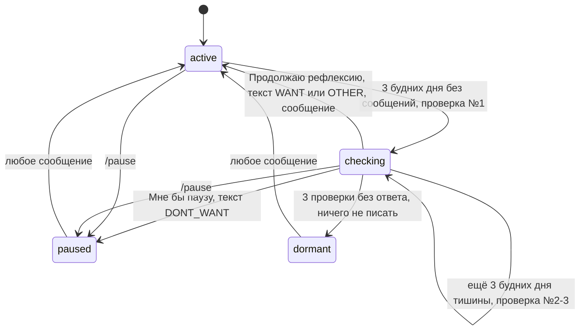

# Блок 5. Молчание и пауза

**Кратко (TL;DR).** Вместо интерпретаций молчания — машина состояний `engagement_state`: `active` → `checking` (3 будних дня без сообщений, до 3 проверок формата) → `paused` (по просьбе) или `dormant` (3 проверки без ответа). Бот не объясняет причины молчания, не давит и уважает ответ «не хочу». Счётчик молчания считает только будние дни. Любое сообщение пользователя из `paused` / `dormant` возвращает в `active`. Тексты проверок №2 и №3 и финальное сообщение при `dormant` — открытые вопросы.

## Состояния

| Состояние | Что делает бот |
|---|---|
| `active` | Обычный режим: утреннее сообщение, вечерняя рефлексия, закрывающие сообщения |
| `checking` | Идёт проверка формата общения. Утренних, вечерних и закрывающих сообщений нет |
| `paused` | Пользователь выбрал «Мне бы паузу» (или `/pause`). Бот молчит; в субботу приходит резюме или заготовка |
| `dormant` | Три проверки без ответа. Бот молчит полностью, пока пользователь сам не напишет |

## Правила

| № | Правило | Параметр |
|---|---|---|
| B5-01 | Состояния: `active`, `checking`, `paused`, `dormant` (таблица выше). Бот не объясняет причины молчания, не давит, уважает ответ «не хочу». Из `prompts.py` любые объяснения причин молчания убираются | — |
| B5-02 | `active` → `checking`: 3 будних дня без сообщений пользователя. Счёт идёт только по будням: сб и вс в него не входят ([как считаются будни](../decisions/2026-10-14-silence-weekdays-and-return.md)). Действие: проверка №1, `silence_checks_count = 1` | [P-SILENCE-DAYS](../parameters.md#вечер-и-молчание-блоки-45) |
| B5-03 | Проверка №1 — сообщение-заготовка Насти (5 вариантов, с именем, по кругу) и кнопки «Продолжаю рефлексию» / «Мне бы паузу» | [P-SILENCE-CHECK-VARIANTS](../parameters.md#вечер-и-молчание-блоки-45) |
| B5-04 | «Продолжаю рефлексию» → `active`, счётчик = 0 (возврат сразу, без ожидания сообщения) | — |
| B5-05 | «Мне бы паузу» → `paused`; признающее сообщение Насти (6 вариантов, по кругу) | [P-PAUSE-ACK-VARIANTS](../parameters.md#вечер-и-молчание-блоки-45) |
| B5-06 | Текстовый ответ вместо кнопки классифицирует дешёвый запрос к Claude: `WANT` → `active`; `DONT_WANT` → `paused`; `OTHER` → обычное сообщение, `active` ([граничные случаи](../decisions/2026-10-14-silence-reply-handling.md)) | — |
| B5-07 | Содержательное сообщение в `checking` → `active`, счётчик = 0 | — |
| B5-08 | `checking` и ещё 3 будних дня тишины: счётчик меньше 3 → проверка №N+1, счётчик +1; счётчик = 3 → `dormant`, ничего не писать | [P-SILENCE-DAYS](../parameters.md#вечер-и-молчание-блоки-45), [P-MAX-SILENCE-CHECKS](../parameters.md#вечер-и-молчание-блоки-45) |
| B5-09 | `paused` / `dormant` → `active` по любому сообщению пользователя; счётчик = 0; бот напоминает, как он работает, что ожидается от пользователя в течение дня, и текущий фокус | — |
| B5-10 | Пауза (`paused`) не истекает сама: выход только по сообщению пользователя | — |
| B5-11 | Возвращением считается любое сообщение пользователя (уточнение для команд и кризисных сообщений — в [решении](../decisions/2026-10-14-silence-weekdays-and-return.md)) | — |
| B5-12 | Закрывающие сообщения вечера не считаются ответом и не сбрасывают таймер тишины ([B4-16](4-evening.md)) | — |
| B5-13 | Время проверки №1: на 3-й будний день молчания в вечернее время из контракта вместо вопроса-приглашения 4.б (одно сообщение вместо двух) ([решение](../decisions/2026-10-14-silence-check-time.md)). Дни 1–2 идут как обычно (приглашение → 30 минут → закрывающее) | [P-EVENING-TIME-DEFAULT](../parameters.md#онбординг-и-контракт-блоки-01) |
| B5-14 | Проверки №2 и №3 приходят так же — в вечернее время из контракта | — |
| B5-15 | `checking`: в субботу приходит недельное резюме по имеющемуся материалу; если наблюдений за неделю нет совсем — резюме не отправляется ([решение](../decisions/2026-10-14-weekly-on-checking.md); [Блок 6](../README.md)) | — |
| B5-16 | `paused`: в субботу приходит недельное резюме по имеющемуся материалу; если материала нет — заготовка «пользователь взял паузу» (2 варианта по кругу, допущение, подтвердить). В `dormant` резюме не отправляется | [P-WEEKLY-ON-PAUSE-VARIANTS](../parameters.md#вечер-и-молчание-блоки-45) |
| B5-17 | Из `paused` и `dormant` утренние сообщения не отправляются; в `checking`, `paused`, `dormant` вечерние и закрывающие сообщения не уходят ([B3-04](3-daily.md), [B4-04](4-evening.md)) | — |
| B5-18 | `/pause` ставит то же состояние `paused`, что кнопка «Мне бы паузу», с тем же признающим текстом ([commands.md](../commands.md)) | — |
| B5-19 | Для разработки (BOT-25): поля пользователя `engagement_state` (по умолчанию `active`), `silence_checks_count` (0), `last_check_at`, `last_user_message_at`, `last_phrase_id`, `preferred_format`. Все переходы — в одной функции `advance_engagement(user)`, чтобы логику тестировать без Telegram. Миграция безопасна для существующих: все `active`, счётчик 0, `last_user_message_at` = дата последнего сообщения | — |

## Таблица переходов

| Из | Событие | В | Правило |
|---|---|---|---|
| `active` | 3 будних дня без сообщений | `checking` (проверка №1) | B5-02 |
| `checking` | «Продолжаю рефлексию» | `active` | B5-04 |
| `checking` | «Мне бы паузу» | `paused` | B5-05 |
| `checking` | текстовый ответ вместо кнопки | `active` / `paused` по классификации | B5-06 |
| `checking` | содержательное сообщение | `active` | B5-07 |
| `checking` | ещё 3 будних дня тишины, счётчик < 3 | `checking` (проверка №N+1) | B5-08 |
| `checking` | ещё 3 будних дня тишины, счётчик = 3 | `dormant` | B5-08 |
| `paused` / `dormant` | любое сообщение | `active` | B5-09 |
| `active` / `checking` | `/pause` | `paused` | B5-18 |

## Тексты Насти

Ключи в `texts.py` (текст в спеке не дублируем):

- проверка №1 — `SILENCE_DAY3_MESSAGES`, функция `silence_day3_message` (5 вариантов, BOT-9) (B5-03);
- признание паузы — `PAUSE_ACK_MESSAGES` (6 вариантов, BOT-10) (B5-05);
- недельное резюме на паузе — `WEEKLY_ON_PAUSE_MESSAGES` (2 варианта, BOT-11) (B5-16);
- проверки №2 и №3 — `SILENCE_CHECK_2_TEXT`, `SILENCE_CHECK_3_TEXT` (пока пусто, `TBD-Настя`, генерация с пометкой) (B5-14);
- ответ на «Продолжаю рефлексию» — `SILENCE_CONTINUE_TEXT` (пока пусто, `TBD-Настя`) (B5-04);
- напоминание при возвращении — `RETURN_REMINDER_TEXT` (пока пусто, `TBD-Настя`) (B5-09).

## Схема

## Эталонные сценарии

Тестовые сценарии из спеки (BOT-25):

1. 3 будних дня тишины → проверка №1 → «Продолжаю» → `active`.
2. Проверка №1 → «Мне бы паузу» → `paused` → любое сообщение → `active`.
3. Проверка №1 → тишина → №2 → тишина → №3 → тишина → `dormant`.
4. `active`, вечерний вопрос без ответа → закрывающее, таймер тишины не сброшен.
5. `dormant` + «привет» → `active`.
6. В `checking`, `paused`, `dormant` вечерние сообщения не уходят.

## Связанное

- Предыдущий блок: [Блок 4 — вечер](4-evening.md); следующий: [Блок 6](../README.md)
- Команды: [commands.md](../commands.md) (`/pause`)
- Параметры: [parameters.md](../parameters.md#вечер-и-молчание-блоки-45)
- Решения: [время проверки](../decisions/2026-10-14-silence-check-time.md), [резюме при checking](../decisions/2026-10-14-weekly-on-checking.md), [будни и возвращение](../decisions/2026-10-14-silence-weekdays-and-return.md), [граничные случаи](../decisions/2026-10-14-silence-reply-handling.md)
- Соседние: [B1-06](1-contract.md) (реакция на молчание в контракте)
- Открытые вопросы: [60-open-questions.md](../../tasks/60-open-questions.md)

[← К оглавлению](../README.md)
