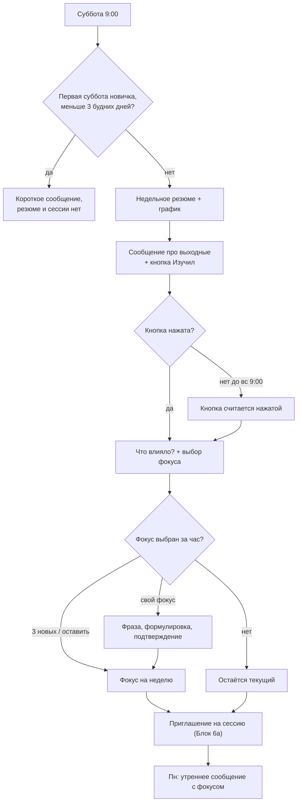

# Блок 6. Недельный цикл

**Кратко (TL;DR).** В субботу в 9:00 бот присылает недельное резюме (текст и график в чате), сразу за ним — сообщение про выходные с кнопкой «Изучил, готов продолжить». После кнопки — вопрос «Что влияло?» и выбор фокуса на следующую неделю (не дольше часа), затем приглашение на сессию ([Блок 6а](6a-session.md)). Первая суббота новичка может быть без резюме. Открыты: несколько фокусов за неделю, тексты Насти (сообщение про выходные, связка выбора фокуса, структура резюме), пороги звёздочек.

## Правила

| № | Правило | Параметр |
|---|---|---|
| B6-01 | Недельное резюме приходит в субботу в 9:00 (GMT+3), независимо от количества наблюдений за неделю | [P-WEEKLY-TIME](../parameters.md#недельный-цикл-и-сессия-блок-6), [P-WEEKLY-WINDOW-MIN](../parameters.md#недельный-цикл-и-сессия-блок-6) |
| B6-02 | Первая суббота новичка: резюме приходит, только если с момента фиксации фокуса прошло 3 будних дня или больше. Иначе в эту субботу резюме нет, бот присылает короткое сообщение `WEEKLY_SHORT_FIRST_WEEK_TEXT`; фокус остаётся прежним, сессия на этой неделе не предлагается ([как считаются дни](../decisions/2026-10-14-weekly-newcomer-count.md)) | [P-NEWCOMER-MIN-WEEKDAYS](../parameters.md#недельный-цикл-и-сессия-блок-6) |
| B6-03 | Материал резюме — всё с предыдущего недельного резюме: с прошлой субботы 9:00 до этой (прошлые сб–вс и текущие пн–пт), «от резюме до резюме» ([границы окна](../decisions/2026-10-14-weekly-window-and-observations.md)) | — |
| B6-04 | Звёздочки регулярности считаются только по будним дням пн–пт; выходные регулярность не повышают и не понижают | — |
| B6-05 | Звёздочки объёма считаются по всем наблюдениям окна, включая выходные | [P-STARS-VOLUME-THRESHOLDS](../parameters.md#недельный-цикл-и-сессия-блок-6) |
| B6-06 | В окно не входят сообщения сессии ([Блок 6а](6a-session.md), B6A-09) и ответы на «Что влияло?» (B6-12) | — |
| B6-07 | Если наблюдений мало, бот честно обозначает это: `WEEKLY_FEW_OBSERVATIONS_TEXT`. Без осуждения, без пустой аналитики. Если наблюдений нет совсем — короткая заготовка `WEEKLY_NO_OBSERVATIONS_TEXT` без нейронки ([допущение](../decisions/2026-10-14-weekly-stars-and-few.md)) | [P-WEEKLY-FEW-OBSERVATIONS](../parameters.md#недельный-цикл-и-сессия-блок-6) |
| B6-08 | Резюме приходит текстом и графиком в чате, без PDF. Часть 1 — сводка наблюдений и рефлексий по обозначенным фокусам; если фокус был один, разбор по нему | — |
| B6-09 | 🔴 Открыто: допускается ли несколько фокусов за неделю (сейчас фокус один, BOT-28 п. 8) | — |
| B6-10 | Часть 2 — качество рефлексии: звёздочки за регулярность (дни с наблюдениями из будних) и за объём; без осуждения, поощряюще. Правило подсчёта простое, в коде, без нейронки; пороги задают Тимур и Настя. График — только по регулярности. Оценки запроса в субботу нет, «разрыва X→Y» нет | [P-STARS-VOLUME-THRESHOLDS](../parameters.md#недельный-цикл-и-сессия-блок-6), [P-STARS-MAX](../parameters.md#недельный-цикл-и-сессия-блок-6) |
| B6-11 | Часть 3 — «Что заметил бот»: короткий вывод по материалу недели. Структура и инструкция резюме — `WEEKLY_SUMMARY_PROMPT_NASTYA` (пока пусто, `TBD-Настя`) | — |
| B6-12 | Один вопрос `WEEKLY_INFLUENCE_QUESTION` («Что влияло?») задаётся после кнопки «Изучил, готов продолжить» и сохраняется как обратная связь по выводу бота (B6-11); подводит к выбору фокуса (B6-13). «Это» — вывод бота, а не оценка: еженедельной оценки запроса нет, сравнение «было X, стало Y» перенесено в месячный срез (Блок 7) | — |
| B6-13 | Выбор фокуса на следующую неделю (кнопки, пронумерованные варианты): 3 новых фокуса по материалу недели (тот же запрос с разных сторон); «оставить текущий»; «свой фокус» (B6-21). Связка перед вариантами — `WEEKLY_FOCUS_CHOICE_TEXT` | [P-FOCUS-OPTIONS-COUNT](../parameters.md#ежедневный-сбор-и-фокус-блоки-23) |
| B6-14 | В понедельник бот пишет утреннее сообщение с новым фокусом ([Блок 3](3-daily.md), B3-02) | — |
| B6-15 | Фокус можно сменить и раньше, в любой день: `/focus` или кнопка «Сменить фокус» в дашборде (единый путь, [B3-20](3-daily.md)). Запрос при смене фокуса не меняется | — |
| B6-16 | Сразу после резюме — отдельное сообщение про выходные: ознакомься с резюме, поразмышляй, сделай пометки; суббота и воскресенье — дни паузы; можно присылать наблюдения, можно нет; вечерних резюме не будет; всё присланное учтётся в понедельник. Текст — `WEEKEND_AFTER_SUMMARY_TEXT`. Под сообщением — кнопка «Изучил, готов продолжить» (название рабочее) | — |
| B6-17 | Порядок субботы: (1) недельное резюме (части 1–3); (2) сообщение про выходные с кнопкой «Изучил»; (3) после кнопки — одно сообщение: «Что влияло?» и под ним выбор фокуса (можно ответить текстом, нажать кнопку или и то и другое); (4) приглашение на сессию «Сейчас» / «Позже» после выбора фокуса ([B6A-02](6a-session.md)) | — |
| B6-18 | Пока кнопка «Изучил» не нажата, других действий в субботнем потоке нет. Приём наблюдений и кризисная проверка работают всё это время, в том числе до нажатия кнопки: ограничение относится только к субботнему потоку | — |
| B6-19 | Если кнопка не нажата, напоминаний нет. В воскресенье в 9:00 кнопка считается нажатой, и всё идёт как после нажатия: «Что влияло?» с выбором фокуса (с тем же ожиданием) и приглашение на сессию. Это исключение из правила «в выходные бот сам не пишет». Если фокус не выбран, остаётся текущий. 🔴 Открыто: дословные тексты вступления и напоминания про концентрацию (от Насти) | [P-WEEKLY-TIME](../parameters.md#недельный-цикл-и-сессия-блок-6) |
| B6-20 | Шаг (3) «Что влияло?» + выбор фокуса ждёт не дольше часа. Фокус не выбран за час — остаётся текущий, бот переходит к шагу (4) | [P-WEEKLY-CHOICE-WAIT-MIN](../parameters.md#недельный-цикл-и-сессия-блок-6) |
| B6-21 | «Свой фокус» в субботу — короткий шаг, не полный диалог [Блока 2](2-focus.md): пользователь пишет фразу, бот предлагает уточнённую формулировку на подтверждение кнопкой. Пока шаг идёт, часовой таймер B6-20 остановлен, но не дольше суток ([допущение](../decisions/2026-10-14-weekly-own-focus-timeout.md)). Ответ, пришедший после перехода, принимается как обычное наблюдение ([Блок 3](3-daily.md)). Пример сообщения и кнопок — `../product/пример_субботнего_выбора_фокуса.md` | [P-WEEKLY-OWN-MAX-HOURS](../parameters.md#недельный-цикл-и-сессия-блок-6) |
| B6-22 | В `checking` и `paused` суббота идёт по правилам [B5-15, B5-16](5-silence.md); суббота и её кнопки не сбрасывают отсчёт тишины и не меняют состояние ([допущение](../decisions/2026-10-14-weekly-silence-interaction.md)) | — |
| B6-23 | Если субботний поток прошлой недели не завершён к следующей субботе, он заменяется новым; старые кнопки ничего не делают ([допущение](../decisions/2026-10-14-weekly-unfinished-flow.md)) | — |

Тексты Насти: ключи в `texts.py` (`WEEKLY_SHORT_FIRST_WEEK_TEXT`, `WEEKLY_FEW_OBSERVATIONS_TEXT`, `WEEKLY_NO_OBSERVATIONS_TEXT`, `WEEKLY_INFLUENCE_QUESTION`, `WEEKEND_AFTER_SUMMARY_TEXT`, `WEEKLY_FOCUS_CHOICE_TEXT`) и промпт `WEEKLY_SUMMARY_PROMPT_NASTYA` в `prompts.py`. Текст в спеке не дублируем. Пока `WEEKEND_AFTER_SUMMARY_TEXT`, `WEEKLY_FOCUS_CHOICE_TEXT` и `WEEKLY_SUMMARY_PROMPT_NASTYA` пусты (`TBD-Настя`): работает генерация по смыслу с пометкой.

## Дашборд

Доступен в любой момент (подробнее — Блок 7, «Дашборд»); с недельным резюме идёт график регулярности (B6-10).

- Динамика оценки запроса (старт и ежемесячные оценки).
- Качество рефлексии: регулярность и объём наблюдений по неделям.
- Если данных мало — визуализация объёма наблюдений по дням недели (сколько сообщений пришло в каждый день).

## Схема

## Связанное

- Следующий: [Блок 6а — сессия](6a-session.md); предыдущий: [Блок 5 — молчание](5-silence.md); месячный срез — Блок 7
- Команды: [commands.md](../commands.md) (`/focus`, `/dashboard`, `/session`)
- Параметры: [parameters.md](../parameters.md#недельный-цикл-и-сессия-блок-6)
- Решения: [окно и наблюдения](../decisions/2026-10-14-weekly-window-and-observations.md), [новичок](../decisions/2026-10-14-weekly-newcomer-count.md), [звёздочки и «мало»](../decisions/2026-10-14-weekly-stars-and-few.md), [свой фокус](../decisions/2026-10-14-weekly-own-focus-timeout.md), [молчание](../decisions/2026-10-14-weekly-silence-interaction.md), [незавершённый поток](../decisions/2026-10-14-weekly-unfinished-flow.md)
- Открытые вопросы: [60-open-questions.md](../../tasks/60-open-questions.md)

[← К оглавлению](../README.md)
