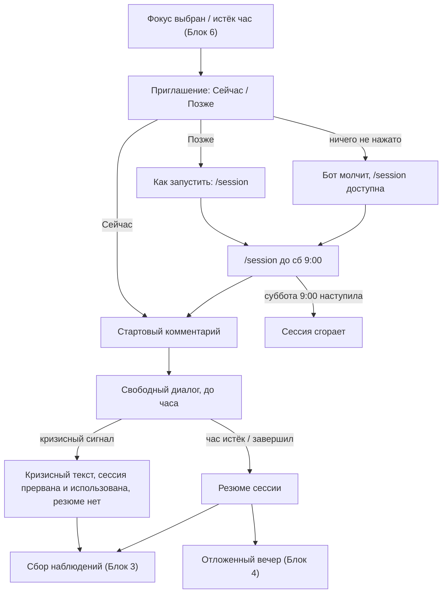

# Блок 6а. Еженедельная сессия с психологом

**Кратко (TL;DR).** Раз в неделю пользователю доступна одна сессия: час свободного общения с ботом в режиме психолога Анастасии. Приглашение приходит после выбора фокуса в субботу ([Блок 6](6-weekly.md)) с кнопками «Сейчас» / «Позже»; «Позже» — запуск командой `/session` до следующего субботнего отчёта, потом сессия сгорает. В конце — резюме сессии, при кризисе — сессия прерывается без резюме. Открыты: тексты Насти, часовые пояса, перенос, что считается «использованной».

Живой психолог в текущую версию не входит (планируется как платная опция).

## Правила

| № | Правило | Параметр |
|---|---|---|
| B6A-01 | Каждую неделю доступна одна сессия: онлайн-общение с ботом в режиме психолога Анастасии. Цель — настроить человека на следующую неделю работы над фокусом | — |
| B6A-02 | Приглашение приходит после выбора фокуса (или после часового ожидания, [B6-20](6-weekly.md)): бот озвучивает возможность сессии, кратко описывает, как она проходит (свободное общение в течение часа; итоги резюме и всё, что человек захочет; нужны сосредоточенность и выделенное время; одна в неделю; неиспользованная сгорает; число сообщений не ограничено; при кризисе прерывается; в конце — резюме) и предлагает кнопки «Сейчас» / «Позже». Текст — `SESSION_INVITE_TEXT`. Сессия недели создаётся в момент приглашения. Если неделя короткая ([B6-02](6-weekly.md)) или пришла заготовка паузы, сессия не предлагается | — |
| B6A-03 | «Сейчас»: стартовый комментарий `SESSION_START_TEXT` (час, о чём можно говорить, концентрация, как закончить раньше), затем свободная терапия (диалог психолога Анастасии, не сбор наблюдений). Контекст для нейронки: профиль пользователя, наблюдения за неделю, последние еженедельные отчёты ([допущение](../decisions/2026-10-14-session-context.md)) | [P-SESSION-MINUTES](../parameters.md#недельный-цикл-и-сессия-блок-6) |
| B6A-04 | «Позже»: бот сообщает, как найти и запустить сессию самостоятельно — команда `/session` (она же в меню команд). Текст — `SESSION_LATER_TEXT`. Запуск «позже» ведёт в тот же сценарий, что «Сейчас». Фиксированного времени и напоминаний нет | — |
| B6A-05 | Кнопки отказа («Сессия не нужна») нет: «Позже» её заменяет. Если человек не нажал ни одну кнопку, бот ничего не делает и не напоминает; сессию можно запустить `/session` ([допущение](../decisions/2026-10-14-session-invite-no-press.md)) | — |
| B6A-06 | Запуск «позже» и `/session` доступны до следующего субботнего отчёта (суббота 9:00 GMT+3), затем сессия сгорает: `/session` отвечает, что сессии нет, и называет дату ближайшей субботы ([допущение](../decisions/2026-10-14-session-deadline.md)) | [P-WEEKLY-TIME](../parameters.md#недельный-цикл-и-сессия-блок-6) |
| B6A-07 | Длительность сессии — час; число сообщений не ограничено (дневного лимита в режиме 2 нет). Сессия не привязана к смене фокуса: после неё бот ничего не предлагает, фокус меняется только в субботнем выборе или через `/focus`. Бот держит линию запроса от сессии к сессии | [P-SESSION-MINUTES](../parameters.md#недельный-цикл-и-сессия-блок-6) |
| B6A-08 | Сессия заканчивается, когда истёк час или человек сам закончил (кнопка «Завершить сессию» или словами). Бот выдаёт резюме сессии: что обсуждалось, к чему пришли, на что обратить внимание на следующей неделе ([формат](../decisions/2026-10-14-session-summary-format.md)); ключ промпта — `SESSION_SUMMARY_PROMPT_NASTYA` | — |
| B6A-09 | Сообщения сессии сбрасывают счётчик молчания ([Блок 5](5-silence.md)); не считаются в «первые 3 сообщения дня» ([B3-08](3-daily.md)) и не входят в охват вечернего резюме ([B4-02](4-evening.md)) и недельного ([B6-06](6-weekly.md)) | — |
| B6A-10 | Если на время сессии приходится вечернее время резюме ([Блок 4](4-evening.md)), вечер откладывается до конца сессии и начинается сразу после её резюме ([допущение](../decisions/2026-10-14-session-evening.md)) | — |
| B6A-11 | Неиспользованная сессия сгорает и не переносится. Следующая возможна через неделю, после следующего субботнего резюме | — |
| B6A-12 | Кризисный сигнал во время сессии: включается режим кризиса ([B3-10…B3-13](3-daily.md)), сессия прерывается. Прерванная сессия считается использованной: повторно запустить её в ту же неделю нельзя. Резюме прерванной сессии не присылается; обсуждённое до прерывания учитывается в контексте следующей сессии. После кризисного текста бот возвращается в сбор наблюдений ([Блок 3](3-daily.md)); вечер в этот день не начинается ([допущение](../decisions/2026-10-14-session-evening.md)) | — |
| B6A-13 | 🔴 Открыто: часовые пояса (в базе UTC, показ GMT+3; как узнавать пояс и показывать время), можно ли перенести сессию до начала, что считается «использованной» (сам факт начала или минимум сообщений), структура резюме сессии, лимит сообщений на сессию | — |

Тексты Насти: ключи `SESSION_INVITE_TEXT`, `SESSION_START_TEXT`, `SESSION_LATER_TEXT` в `texts.py`, промпт `SESSION_SUMMARY_PROMPT_NASTYA` в `prompts.py` (текст в спеке не дублируем). Пока пусты (`TBD-Настя`): генерация по смыслу с пометкой.

## Схема

## Связанное

- Предыдущий: [Блок 6 — недельный цикл](6-weekly.md)
- Команды: [commands.md](../commands.md) (`/session`)
- Параметры: [parameters.md](../parameters.md#недельный-цикл-и-сессия-блок-6)
- Решения: [приглашение без нажатия](../decisions/2026-10-14-session-invite-no-press.md), [срок](../decisions/2026-10-14-session-deadline.md), [контекст](../decisions/2026-10-14-session-context.md), [формат резюме](../decisions/2026-10-14-session-summary-format.md), [вечер и кризис](../decisions/2026-10-14-session-evening.md)
- Открытые вопросы: [60-open-questions.md](../../tasks/60-open-questions.md)

[← К оглавлению](../README.md)
