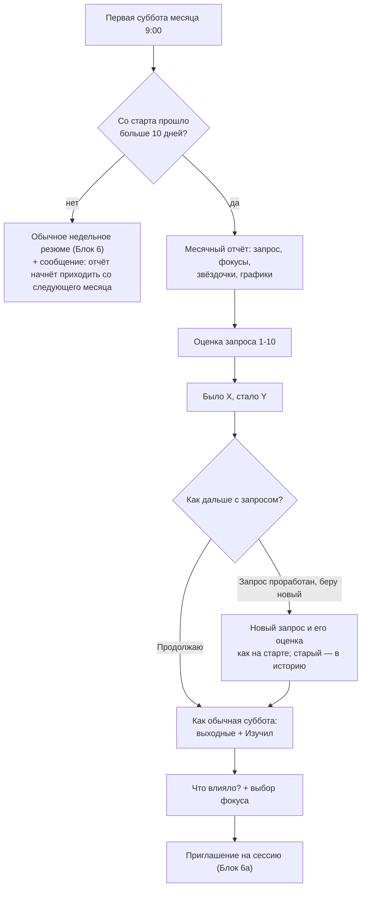

# Блок 7. Месячный срез

**Кратко (TL;DR).** В первую субботу месяца вместо недельного резюме бот присылает месячный отчёт с графиками, просит оценить запрос от 1 до 10 и показывает «было X, стало Y», затем предлагает «Продолжаю с этим запросом» / «Запрос проработан, беру новый». Дальше идёт обычная суббота ([Блок 6](6-weekly.md)): сообщение про выходные, «Что влияло?» с выбором фокуса, приглашение на сессию. Срез приходит, только если со старта прошло больше 10 дней. Запрос меняется только здесь. Открыты: тексты Насти (структура отчёта, сравнение оценок), вторая шкала прогресса, форма дашборда.

## Правила

| № | Правило | Параметр |
|---|---|---|
| B7-01 | Бот сам, в первую субботу нового месяца (число 1–7 по GMT+3) в 9:00, присылает месячный срез вместо обычного недельного резюме. Колесо баланса из среза убрано; отчёт приходит текстом и графиками в чате, без файла | [P-WEEKLY-TIME](../parameters.md#недельный-цикл-и-сессия-блок-6) |
| B7-02 | Срез приходит, только если с начала использования бота (первый вход в режим 2; у перенесённых пользователей — момент сброса) прошло больше 10 дней. Иначе в эту субботу идёт обычное недельное резюме ([Блок 6](6-weekly.md), с правилом первой субботы) и бот присылает сообщение `MONTHLY_TOO_EARLY_TEXT` ([как считается срок](../decisions/2026-10-14-monthly-start-condition.md)) | [P-MONTHLY-MIN-DAYS](../parameters.md#месячный-срез-и-дашборд-блок-7) |
| B7-03 | Если в эту же субботу у новичка не набралось 3 будних дней для недельного резюме ([B6-02](6-weekly.md)), отправляется только сообщение `MONTHLY_TOO_EARLY_TEXT` (без «Первая неделя была короткой…») | [P-NEWCOMER-MIN-WEEKDAYS](../parameters.md#недельный-цикл-и-сессия-блок-6) |
| B7-04 | Порядок среза: (1) отчёт за месяц; (2) оценка запроса 1–10 и сравнение «было X, стало Y»; (3) «Продолжаю с этим запросом» / «Запрос проработан, беру новый»; (4) сообщение про выходные с кнопкой «Изучил, готов продолжить» ([B6-16](6-weekly.md)); (5) «Что влияло?» с выбором фокуса одним сообщением; (6) приглашение на сессию «Сейчас» / «Позже» ([B6A-02](6a-session.md)). Шаги 4–6 — как в обычной субботе | — |
| B7-05 | Отчёт: запрос, все фокусы месяца, динамика оценки запроса и качества рефлексии (регулярность и объём; звёздочки по неделям), графики, сравнение с предыдущим месяцем, если данные есть ([как считается окно и сравнение](../decisions/2026-10-14-monthly-window-and-report.md)). Месячный срез полностью заменяет недельное резюме этой субботы | — |
| B7-06 | Структура и инструкция месячного отчёта — `MONTHLY_SUMMARY_PROMPT_NASTYA` (пока пусто, `TBD-Настя`; до тех пор отчёт помечается «текст вместо …»). 🔴 Открыто: структура отчёта (от Насти) | — |
| B7-07 | Оценка запроса 1–10 от пользователя (кнопки, шкала та же, что на старте; можно числом). Запрос оценивается и на старте, и раз в месяц. Недельных оценок запроса или фокуса нет | [P-MONTHLY-STEP-WAIT-MIN](../parameters.md#месячный-срез-и-дашборд-блок-7) |
| B7-08 | Если оценка не поставлена за час, срез идёт дальше без новой точки. Ответ не числом — обычное наблюдение ([Блок 3](3-daily.md)) ([допущение](../decisions/2026-10-14-monthly-steps-wait.md)) | [P-MONTHLY-STEP-WAIT-MIN](../parameters.md#месячный-срез-и-дашборд-блок-7) |
| B7-09 | После оценки бот показывает «было X, стало Y» как данные, а не зачёт, в духе каркаса: «Месяц назад было [X], сейчас [Y]. Это просто данные — не оценка тебя.» «Было X» — последняя оценка этого запроса (стартовая или прошлая месячная). Текст — `MONTHLY_SCORE_COMPARE_TEXT` (пока пусто, `TBD-Настя`). 🔴 Открыто: дословный текст (от Насти) | — |
| B7-10 | Смена запроса — только в месячном срезе. После оценки и сравнения бот предлагает кнопки «Продолжаю с этим запросом» / «Запрос проработан, беру новый». В другие дни (`/focus`, дашборд) запрос не меняется; запрос по умолчанию тоже меняется только здесь | — |
| B7-11 | «Запрос проработан, беру новый»: новый запрос задаётся как на старте ([Блок 2](2-focus.md), шаг 0: запрос по желанию, оценка обязательна), затем выбор фокуса в рамках нового запроса. Прежний запрос закрывается и остаётся в истории дашборда как проработанный ([допущение](../decisions/2026-10-14-monthly-new-request.md)) | [P-MONTHLY-STEP-WAIT-MIN](../parameters.md#месячный-срез-и-дашборд-блок-7) |
| B7-12 | Каждый шаг (оценка, выбор запроса, новый запрос, оценка нового) ждёт не дольше часа. Нет выбора или нового запроса — запрос остаётся прежним; нет оценки нового запроса — бот спросит её при следующем сообщении, как на старте | [P-MONTHLY-STEP-WAIT-MIN](../parameters.md#месячный-срез-и-дашборд-блок-7) |
| B7-13 | Выбор фокуса на следующую неделю — по той же схеме, что в [Блоке 6](6-weekly.md) ([B6-13](6-weekly.md), [B6-20](6-weekly.md)); месячный срез сохраняется как отчёт недели для контекста сессии ([Блок 6а](6a-session.md)) | — |
| B7-14 | 🔴 Открыто: вторая шкала для случая, когда запрос объективно не изменился (внутреннее состояние, комфорт), чтобы виден был прогресс. Решено пока не вводить; вернуться позже, возможно с вопросами на старте | — |

### Дашборд

Общий обзор дашборда и график регулярности — в [Блоке 6, «Дашборд»](6-weekly.md#дашборд); здесь только то, чего там нет. Доступен командой `/dashboard` в любой момент ([commands.md](../commands.md)).

| № | Правило | Параметр |
|---|---|---|
| B7-15 | Дашборд показывает: динамику оценки запроса и отдельно качество рефлексии (регулярность и объём), текущий запрос (с даты) и фокус, историю прошлых запросов — как заслугу пользователя (после проработки можно взять новый на несколько месяцев) | [P-DASHBOARD-WEEKS](../parameters.md#месячный-срез-и-дашборд-блок-7) |
| B7-16 | Кнопка «Сменить фокус» ведёт в `/focus` ([B3-20](3-daily.md)). Если сессия этой недели не использована, дашборд показывает это и кнопку «Начать сессию» ([Блок 6а](6a-session.md)) | — |
| B7-17 | Форма дашборда ([допущение о составе](../decisions/2026-10-14-dashboard-contents.md)): сейчас команда в чате. 🔴 Открыто: мини-приложение Telegram или сгенерированный HTML-файл | — |

Тексты Насти: ключи в `texts.py` и `prompts.py` (`MONTHLY_TOO_EARLY_TEXT`, `MONTHLY_SCORE_COMPARE_TEXT`, `MONTHLY_SUMMARY_PROMPT_NASTYA`). Текст в спеке не дублируем. `MONTHLY_SCORE_COMPARE_TEXT` и `MONTHLY_SUMMARY_PROMPT_NASTYA` пусты (`TBD-Настя`): работает генерация по смыслу с пометкой. Вопросы оценки и выбора запроса — заготовки разработки в `handlers/monthly.py`, не тексты Насти.

## Схема

## Связанное

- Предыдущий: [Блок 6 — недельный цикл](6-weekly.md), [Блок 6а — сессия](6a-session.md); запрос и оценка на старте — [Блок 2](2-focus.md)
- Команды: [commands.md](../commands.md) (`/dashboard`, `/focus`, `/settings`)
- Параметры: [parameters.md](../parameters.md#месячный-срез-и-дашборд-блок-7)
- Решения: [условие старта](../decisions/2026-10-14-monthly-start-condition.md), [окно и отчёт](../decisions/2026-10-14-monthly-window-and-report.md), [ожидание шагов](../decisions/2026-10-14-monthly-steps-wait.md), [новый запрос](../decisions/2026-10-14-monthly-new-request.md), [состав дашборда](../decisions/2026-10-14-dashboard-contents.md)
- Открытые вопросы: [60-open-questions.md](../../tasks/60-open-questions.md)

[← К оглавлению](../README.md)
